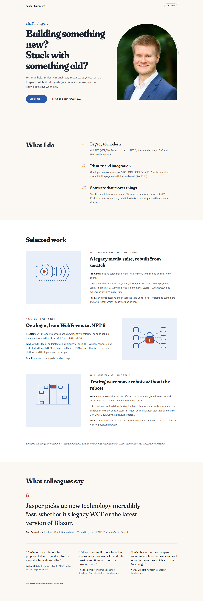

# Direction A: Warm editorial

Archived 2026-10-21. Original route: `/directions/a`. Working state: tag `design-directions-v1`.

## Mood
A well-made magazine profile: calm, confident, personal. Generous whitespace, a narrow reading column, and testimonials as large pull quotes.

## Fonts
- Headings: Fraunces Variable (soft serif, `SOFT` 100 and `WONK` 1 for a friendly, slightly quirky headline). Package: `@fontsource-variable/fraunces` (uses `full.css` and `full-italic.css` for the extra axes).
- Body: Source Sans 3 Variable. Package: `@fontsource-variable/source-sans-3` (still installed, used by D).

## Colour tokens
| Token | Hex |
| --- | --- |
| bg (warm paper) | `#FBF8F3` |
| ink | `#1B2430` |
| muted | `#4B5563` |
| accent (blazer blue) | `#2B5BA8` |
| accent-deep | `#1E3F78` |
| tint | `#E9EFF8` |
| rule | `#E4DED3` |
| spark (terracotta, details only) | `#B5452F` |

## Layout and motion
- Hero as a two-column spread: big serif headline left, photo in an arched frame right with an offset outline.
- What I do: sticky heading left, roman-numeral list right.
- Selected work: numbered editorial entries ("No. 1"), art and text alternating sides.
- Quotes: one large featured pull quote, the other three in a row below.
- Motion: slow fade-and-rise of the headline lines, photo revealed from the bottom, hairline rules drawing in on scroll.

## What we liked
Claude's assessment (your own reasons were not recorded): the most "personal" and readable of the four; the featured pull quote gives the recommendations real weight; the serif sets it apart from typical freelance-IT sites.

## Why it wasn't chosen
D was chosen. Claude's assessment: A steps outside the brief's palette (off-white paper and a terracotta accent), and its calm editorial tone is less playful than the brief's "personality from type and motion".

## Files
`src/pages/directions/a.astro`, `src/components/directions/a/*` (Hero, WhatIDo, Work, Quotes), `src/styles/directions/a.css`. It also depends on shared files that stayed in the project: `src/components/directions/WorkArt.astro`, `src/data/site.ts`, `src/layouts/BaseLayout.astro`, `src/assets/jasper.png`.
