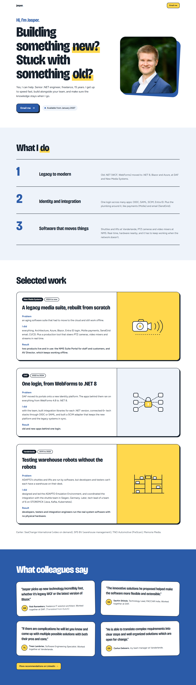

# Direction B: Bold and playful

Archived 2026-10-21. Original route: `/directions/b`. Working state: tag `design-directions-v1`.

## Mood
Friendly energy, closest to robbowen.digital: big confident type, chunky borders, a bit of fun.

## Fonts
- Headings: Bricolage Grotesque Variable at extra-bold weights, narrowed with `wdth` 85. Package: `@fontsource-variable/bricolage-grotesque` (uses `standard.css`).
- Body: Figtree Variable. Package: `@fontsource-variable/figtree` (still installed, used by D).

## Colour tokens
| Token | Hex |
| --- | --- |
| bg | `#FFFFFF` |
| ink | `#16202C` |
| muted | `#475263` |
| accent (blazer blue) | `#2B5BA8` |
| accent-deep | `#1E3F78` |
| tint | `#EEF3FA` |
| marker (highlighter yellow, never for text) | `#FFD84D` |

## Layout and motion
- Hero: very large headline with a yellow marker behind "new?" and "old?", photo in a squircle on a tilted blue block.
- What I do: three rows with oversized numbers between thick rules, on a tint band.
- Selected work: cards with 2px ink borders and a solid offset shadow, art panels in yellow or tint.
- Quotes: white speech cards, slightly tilted, on a full blue band, with initials avatars.
- Motion: greeting waves in letter by letter, marker sweeps behind words, cards lift and tilt on hover, the work illustrations animate (camera pans, lock clicks, shuttles slide).

## What we liked
Claude's assessment (your own reasons were not recorded): the most energetic and memorable; the marker highlight on "new?" and "old?" lands the headline; the animated illustrations show the playful motion the brief asks for.

## Why it wasn't chosen
D was chosen. Claude's assessment: B adds a yellow that the brief's palette doesn't have, and the brutalist borders and shadows feel louder than the brief's "clean white with blazer blue". D keeps much of B's playfulness within the brief.

## Files
`src/pages/directions/b.astro`, `src/components/directions/b/*` (Hero, WhatIDo, Work, Quotes), `src/styles/directions/b.css`. It also depends on shared files that stayed in the project: `src/components/directions/WorkArt.astro`, `src/data/site.ts`, `src/layouts/BaseLayout.astro`, `src/assets/jasper.png`.
