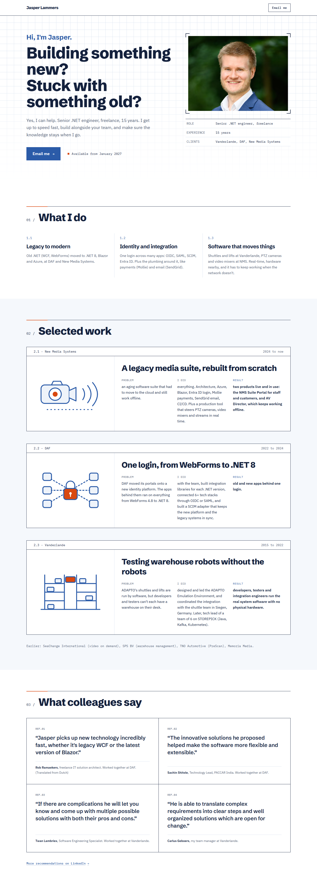

# Direction C: Engineering spec sheet

Archived 2026-10-21. Original route: `/directions/c`. Working state: tag `design-directions-v1`.

## Mood
Precise, structured and scannable: a clean technical drawing on white paper.

## Fonts
- Headings: Schibsted Grotesk Variable at extra-bold weights. Package: `@fontsource-variable/schibsted-grotesk`.
- Body: IBM Plex Sans 400 and 600. Package: `@fontsource/ibm-plex-sans`.
- Labels only (dates, section numbers, spec table): IBM Plex Mono 400 and 500. Package: `@fontsource/ibm-plex-mono`.

## Colour tokens
| Token | Hex |
| --- | --- |
| bg | `#FFFFFF` |
| ink | `#14213D` |
| muted | `#4A5670` |
| accent (blazer blue) | `#2B5BA8` |
| accent-deep | `#1E3F78` |
| tint | `#EEF3FA` |
| rule (grid lines) | `#D9E2EF` |
| spark (signal orange, markers only) | `#D9480F` |

## Layout and motion
- Hero on a faint blueprint grid; photo with crop marks; a spec table below it (Role, Experience, Clients) for brokers to scan.
- Numbered sections ("01 / What I do") with an ink rule and a short orange tick.
- Selected work as bordered sheets with a mono header row and Problem / I did / Result in three columns.
- Quotes in a 2x2 bordered grid labelled REF.01 to REF.04.
- Motion: crisp and mechanical; rules draw in, the photo and illustrations are "plotted" left to right.

## What we liked
Claude's assessment (your own reasons were not recorded): the fastest to scan for brokers, thanks to the spec table and the three-column Problem / I did / Result layout.

## Why it wasn't chosen
D was chosen. Claude's assessment: the mono labels, grid and orange markers lean technical, close to the "terminal styling" the brief wants to avoid, and it is the least warm and personal of the four.

## Files
`src/pages/directions/c.astro`, `src/components/directions/c/*` (Hero, WhatIDo, Work, Quotes, SectionLabel), `src/styles/directions/c.css`. It also depends on shared files that stayed in the project: `src/components/directions/WorkArt.astro`, `src/data/site.ts`, `src/layouts/BaseLayout.astro`, `src/assets/jasper.png`.
