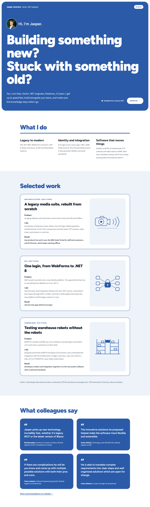

# Variant 1: Text-first hero

Archived 2026-10-21. Original route: `/variants/1`. Working state: tag `design-variants-v1`.

## What it changed (compared to direction D)
- Hero only. The big arched photo is gone; the photo becomes a small round avatar next to "Hi, I'm Jasper."
- The headline grows much larger (up to 8rem on wide screens) and runs across the full width of the blue panel.
- Intro on the left, availability and "Email me" on the right at the bottom of the panel.
- Everything below the hero is D unchanged.

## Fonts
Same as D: Figtree Variable (headings), Source Sans 3 Variable (body).

## Why it wasn't chosen
Variant 2 was chosen. Claude's assessment (your own reasons were not recorded): the headline is loud and confident, but shrinking the photo to an avatar loses the personal first impression the brief asks for, and the full blue panel still makes blue the background instead of the accent.

## Files
`src/pages/variants/1.astro`, `src/components/variants/1/Hero.astro`. It also depends on files that stayed in the project or are only in the tag: `src/components/directions/HeaderName.astro`, `src/components/directions/d/*` (WhatIDo, Work, Quotes), `src/components/directions/WorkArt.astro`, `src/styles/directions/d.css`, `src/data/site.ts`, `src/layouts/BaseLayout.astro`, `src/assets/jasper.png`.
