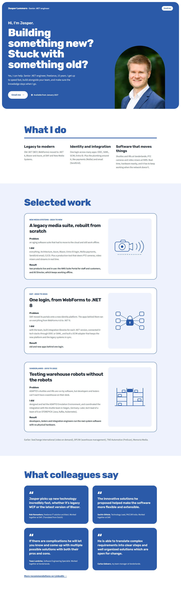

# Variant 3: Rounder display type

Archived 2026-10-21. Original route: `/variants/3`. Working state: tag `design-variants-v1`.

## What it changed (compared to direction D)
- Typography only. Headings switch from Figtree to Rubik (rounded, chunky) at weight 800.
- A bigger type scale for h1 and h2 (fluid `clamp()` sizes up to 5.25rem and 4.75rem).
- Layout, colours and components are D unchanged, including the blue hero panel.

## Fonts
- Headings: Rubik Variable. Package: `@fontsource-variable/rubik` (uninstalled when this variant was archived).
- Body: Source Sans 3 Variable. Package: `@fontsource-variable/source-sans-3`.

## Why it wasn't chosen
Variant 2 was chosen. Claude's assessment (your own reasons were not recorded): Rubik is friendlier, but at large sizes it reads softer and a bit toy-like next to the serious proof below it; Figtree keeps the warmth while staying sharper. The bigger scale also pushed the hero further below the fold on phones.

## Files
`src/pages/variants/3.astro`, `src/styles/variants/3.css`. It also depends on files that stayed in the project or are only in the tag: `src/components/directions/d/*` (Hero, WhatIDo, Work, Quotes), `src/components/directions/HeaderName.astro`, `src/components/directions/WorkArt.astro`, `src/styles/directions/d.css`, `src/data/site.ts`, `src/layouts/BaseLayout.astro`, `src/assets/jasper.png`.
