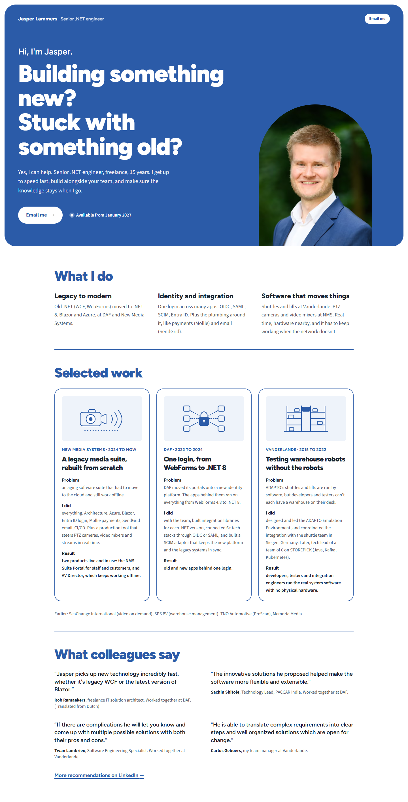

# Variant 4: Compact proof

Archived 2026-10-21. Original route: `/variants/4`. Working state: tag `design-variants-v1`.

## What it changed (compared to direction D)
- Density. Smaller section headings and tighter vertical spacing.
- Thin blue rules between sections instead of alternating white and tint backgrounds.
- Selected work as three cards side by side (illustration on top) instead of the sticky stacking cards.
- Quotes as a plain two-column grid of text with blue quote marks instead of blue cards.
- The hero is D's blue panel, unchanged.

## Fonts
Same as D: Figtree Variable (headings), Source Sans 3 Variable (body).

## Why it wasn't chosen
Variant 2 was chosen. Claude's assessment (your own reasons were not recorded): fast to scan, but the three narrow work cards make long columns of small text, and the plain quotes lose the weight that makes recommendations a main persuasion tool. The page feels more like a CV than a personal site.

## Files
`src/pages/variants/4.astro`, `src/components/variants/4/*` (WhatIDo, Work, Quotes). It also depends on files that stayed in the project or are only in the tag: `src/components/directions/d/Hero.astro`, `src/components/directions/HeaderName.astro`, `src/components/directions/WorkArt.astro`, `src/styles/directions/d.css`, `src/data/site.ts`, `src/layouts/BaseLayout.astro`, `src/assets/jasper.png`.
