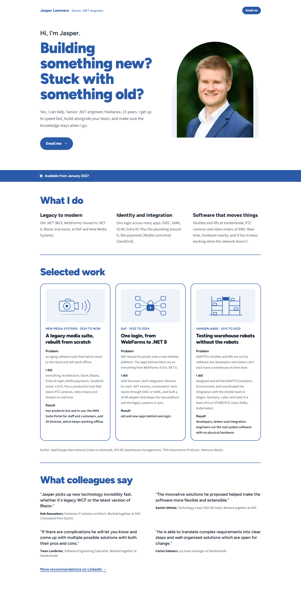

# Variant 5: White hero, compact proof

Archived 2026-10-21. Original route: `/variants/5`. Working state: tag `design-variants-v1`.

## What it changed (compared to direction D)
- A combination: variant 2's white hero (arched photo, blue headline, blue availability band) with variant 4's compact sections below it (tighter spacing, rules between sections, work as three cards, quotes as a plain grid).
- No files of its own besides the page.

## Fonts
Same as D: Figtree Variable (headings), Source Sans 3 Variable (body).

## Why it wasn't chosen
Variant 2 was chosen. Claude's assessment (your own reasons were not recorded): with a white hero and white, rule-separated sections, there is almost no blue left below the band, so the page loses rhythm and the quotes lose their weight. Variant 2 keeps the tint sections and blue quote cards that give the page its character.

## Files
`src/pages/variants/5.astro` only. It depends on variant 2's hero (`src/components/variants/2/Hero.astro`, lives on in the site) and variant 4's components (archived in `../4-compact-proof/src/components/variants/4/`), plus `src/components/directions/HeaderName.astro`, `src/components/directions/WorkArt.astro`, `src/styles/directions/d.css`, `src/data/site.ts`, `src/layouts/BaseLayout.astro`, `src/assets/jasper.png`.
